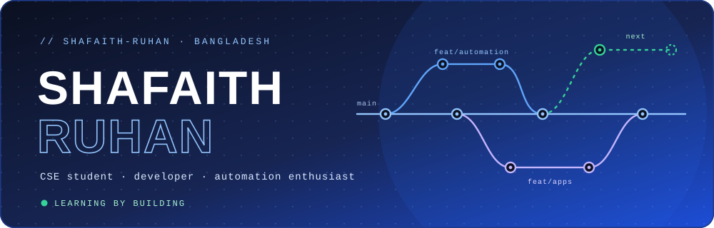

<div align="center">



<br/>


</div>

<br/>


I'm a Computer Science & Engineering student who can't leave an idea alone until it works.

Nobody asked me to build most of what's here. I build because I enjoy it: apps, automations, storefronts, websites. I pick a problem, break it down, ship a first version and keep improving it. That loop is how I learn best.

```yaml
name:      Shafaith Ruhan
studying:  Computer Science & Engineering
from:      Bangladesh
builds:    [web apps, dashboards, automations, websites]
learns_by: building first, reading docs second
languages: [Bengali, English]
next:      a software / AI company of my own
```

<details>
<summary><b>▸ git log --oneline</b> <sub>(open)</sub></summary>

```text
$ git log --oneline --reverse
a1f3c9e  hello world
b72d0e4  found automation, stopped repeating myself
c9a41b8  first storefront: ERAC Lifestyle
d03e7f2  full apps: ISP OneDesk, OLT OneDesk
HEAD     still building, next commit loading...
```

</details>

<br/>


<div align="center">




<a href="https://github.com/shafaith-ruhan/btl-cumilla-isp-daily-report-automation-manager"></a>
<a href="https://github.com/shafaith-ruhan/btl-facebook-messenger-ai-support-automation"></a>


<a href="https://github.com/shafaith-ruhan/erac-lifestyle-showcase"></a>

</div>

<br/>


<div align="center">

**Languages & Web**<br/>


**Backend & Automation**<br/>


**Developer Tools**<br/>


</div>

<br/>


<div align="center">


<br/><br/>


</div>

<br/>


| ▸ NOW | ▸ NEXT | ▸ LATER |
|:--|:--|:--|
| Growing **ISP OneDesk** | Deeper **TypeScript** and backend skills | More polished, production-ready apps |
| Building **OLT OneDesk** | More **API & third-party integrations** | AI-powered products |
| Automating more with **n8n** | Sharper **AI-assisted** workflows | A software / AI company |

<br/>


<div align="center">

<br/>

<a href="mailto:shafaithruhan28@gmail.com"></a>
<a href="https://github.com/shafaith-ruhan"></a>

<br/><br/>


</div>
